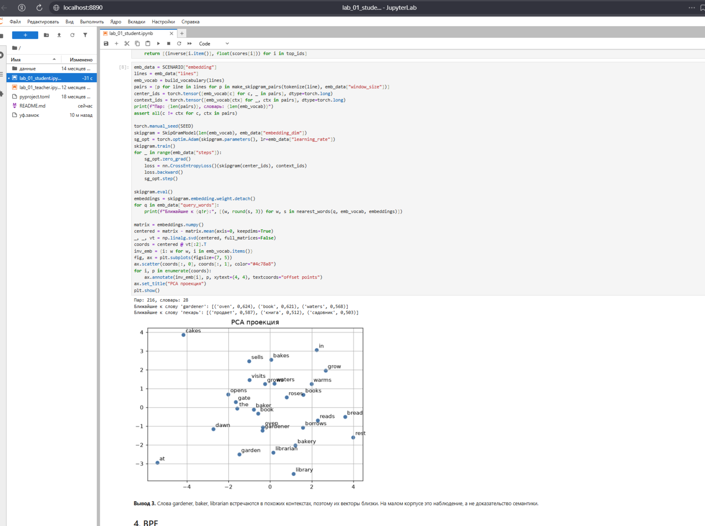

# Лабораторная работа № 01. Основы языковых моделей


В работе реализуются шесть независимых компонентов обработки текста:

1. Токенизация, бинарный BoW и n-граммы.
2. Многоклассовый классификатор на PyTorch (softmax, cross-entropy).
3. Skip-gram и плотные эмбеддинги.
4. Символьная подсловная токенизация BPE.
5. Счётная триграммная языковая модель с backoff и сглаживанием.
6. Метрики качества: перплексия, ROUGE, Лайкерт, Elo.

Каждый компонент самостоятелен. В конце собирается мини-портфолио: BoW+классификатор, skip-gram, BPE, Count LM и метрики.

---

## Структура проекта

```
01-lab-language-model-basics/
├── pyproject.toml           # зависимости (torch, numpy, matplotlib, jupyterlab)
├── uv.lock                  # создаётся автоматически после `uv sync`
├── .venv/                   # виртуальное окружение (создаётся автоматически)
├── README.md
├── data/
│   └── greenfield_town.json # активный профиль Greenfield Town
├── lab_01_student.ipynb     # ЭТО СДАЁТСЯ: задания + реализация
└── lab_01_teacher.ipynb     # эталон (не сдаётся)
```

Дополнительно в исходном архиве курса могут присутствовать:

- `lab_01_example.ipynb` — автономный пример на Harbor Town;
- `lecture_01_language_model_basics_compact.md` / `lecture_01_language_model_basics.md` — компактная и полная лекции;
- `data/brown.txt.gz` — архив Brown Corpus;
- `data/embedding_corpus.txt` — архивный корпус для skip-gram;
- `assets/` — иллюстрации.

В активном маршруте студенту нужны **только** `greenfield_town.json`, `lab_01_student.ipynb` и `pyproject.toml`.

---

## Установка

Требуется Python ≥ 3.12 и [uv](https://docs.astral.sh/uv/).

```bash
pip install uv          # если uv ещё не установлен
uv sync                 # создаст .venv/ и uv.lock по pyproject.toml
```

Команда `uv sync --locked` работает только после того, как `uv.lock` уже создан (например, командой `uv lock`). На первом запуске используйте `uv sync` без `--locked`.

---

## Запуск

Из корня проекта:

```bash
uv run jupyter lab
```

В браузере:

1. Откройте `lab_01_student.ipynb`.
2. Убедитесь, что выбран kernel **Python 3 (ipykernel)**.
3. Выполните **Kernel → Restart Kernel and Run All Cells**.
4. Все ячейки должны пройти без ошибок, а `assert`-проверки после каждого раздела — выполниться.

Если kernel не виден:

```bash
deactivate             # если активировано чужое окружение
uv sync
uv run jupyter lab
```

---

## Что делает ноутбук

### §1. BoW и n-граммы
Реализуются `tokenize`, `build_vocabulary`, `doc_to_bow`, `make_ngrams`. В конце печатается размер словаря, форма DTM, плотность, а также проверяется, что BoW двух переставленных фраз совпадают, а биграммы различаются.

### §2. Softmax и классификатор
Ручной расчёт softmax и кросс-энтропии для логитов `(2.0, 1.0, 0.5)` сравнивается с `torch.softmax` и `nn.CrossEntropyLoss`. Класс `SimpleClassifier` (`Linear → ReLU → Linear`) обучается 800 шагов SGD с `lr=0.05`. Дальше строятся логиты формы `(B, 3)` и предсказанные классы для новых документов.

### §3. Skip-gram
Функция `make_skipgram_pairs` формирует пары «центр — контекст» с окном 2, класс `SkipGramModel` (`nn.Embedding → Linear`) обучается 350 шагов Adam с `lr=0.04`. Функция `nearest_words` возвращает ближайшие слова по косинусному сходству (запрос исключается). Строится PCA-проекция эмбеддингов.

### §4. BPE
Реализуются `initialize_vocabulary`, `get_pair_counts`, `merge_pair`, `byte_pair_encoding`, `tokenize_word`. Проверяется, что размер BPE-словаря не превышает лимит, а слово с неизвестным символом (например, `garden7`) содержит `<UNK>`.

### §5. Count LM
Реализуется триграммная языковая модель: `train`, `predict_next_token`, `get_probability`, `generate_text`, `compute_perplexity`. Проверяется backoff, сглаживание Лапласа, положительная вероятность для неизвестного кандидата и сумма вероятностей по словарю, равная 1.

### §6. Метрики
Реализуются `ngram_counter`, `rouge_n_recall`, `lcs_length`, `rouge_l`, `expected_score`, `update_elo`. Считаются ROUGE-1/2/L для двух кандидатов и Elo для трёх LM. Проверяются диапазоны `[0, 1]` для ROUGE и сохранение суммы Elo (4500).

---

## Инварианты, которые проверяют `assert`

- Форма DTM: `(число документов, размер словаря)`.
- Форма логитов классификатора: `(B, 3)`; сумма вероятностей после softmax = 1.
- В `new_document_logits` ровно `B` строк и 3 столбца.
- В парах skip-gram центр и контекст — разные позиции.
- Запрос `nearest_words` не попадает в свой список соседей.
- Размер `bpe_tokens` ≤ `vocab_size`.
- В токенизации неизвестного символа присутствует `<UNK>`.
- Сумма сглаженных вероятностей Count LM по словарю = 1.
- PPL на непустой тестовой последовательности конечна.
- Все значения ROUGE лежат в `[0, 1]`.
- Сумма Elo-рейтингов = 4500.

---

## Воспроизводимость

- `SEED = 42` для `random`, `numpy`, `torch`.
- Все данные загружаются из `data/greenfield_town.json`.
- Токенизация — регулярное выражение `[a-z]+` после `lower()`. Это обязательное соглашение для совместимости контрольных ячеек; в прикладной задаче токенизатор выбирают под язык.
- Гиперпараметры (размеры слоёв, число шагов, learning rate, `beta`, начальные Elo, `K`) фиксированы в ноутбуке и не должны меняться при базовой сдаче.

---

## Что сдаётся

Сдаётся **только** `lab_01_student.ipynb`. В нём должны быть:

1. Рабочий код всех функций и классов (без `NotImplementedError`).
2. Выполненные ячейки с выводом, в том числе прошедшие `assert`.
3. Ручной расчёт softmax и кросс-энтропии в §2.1.
4. Письменные ответы после каждого раздела по схеме «наблюдение → причина → ограничение», включая три оценки Лайкерта для кандидата A в §6.
5. Успешный обязательный базовый запуск мини-портфолио со всеми `✓`.
6. Заполненный «паспорт результата» и карта адаптации.

`lab_01_teacher.ipynb` и `lab_01_example.ipynb` не сдаются.

---

## Типичные проблемы

| Симптом | Причина | Что сделать |
| --- | --- | --- |
| `error: Unable to find lockfile at uv.lock` | нет `uv.lock`, а вызван `uv sync --locked` | запустить `uv sync` без `--locked` (он создаст lock) |
| `ModuleNotFoundError: torch` | kernel не тот или `uv sync` не доехал | перезапустить Jupyter, выбрать `Python 3 (ipykernel)` |
| `FileNotFoundError: greenfield_town.json` | ноутбук запускается не из корня | положить `data/` рядом с ноутбуком или запускать из корня проекта |
| `NotJSONError: notebook is not JSON` | файл `.ipynb` повреждён при копировании | открыть в текстовом редакторе, восстановить валидный JSON (все строки в `"..."`, все скобки закрыты) |
| `AssertionError` в конкретном разделе | реализация не совпадает с ожиданием | проверить код в этом разделе; частые причины — `set()` вместо `list` в BoW, `argmax(dim=0)` вместо `dim=1`, отсутствие `scores[idx] = -1` в `nearest_words` |
| Числа немного отличаются от teacher | другой корпус/файл `greenfield_town.json` | сверить инварианты; для сдачи обычно используется оригинальный json |

---


